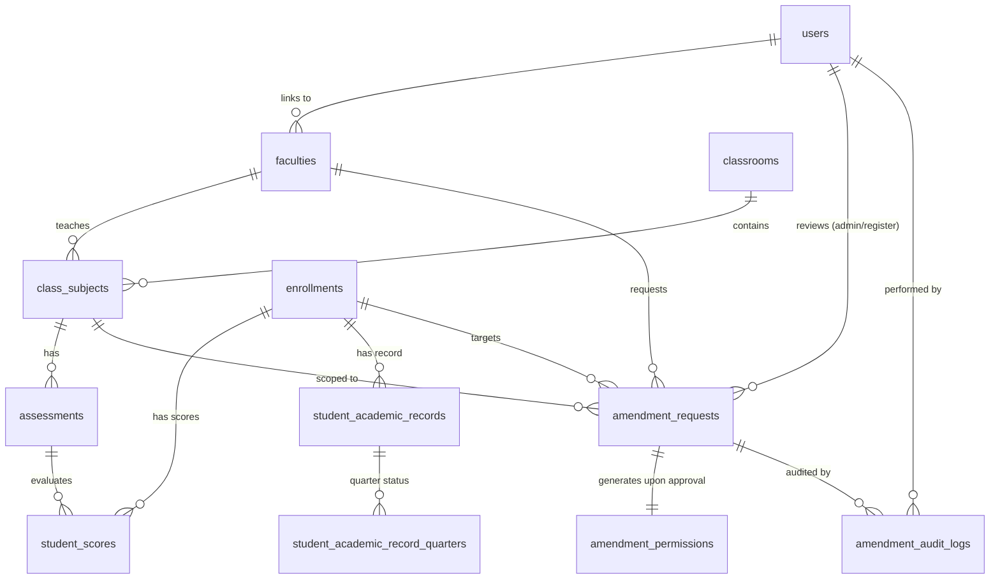
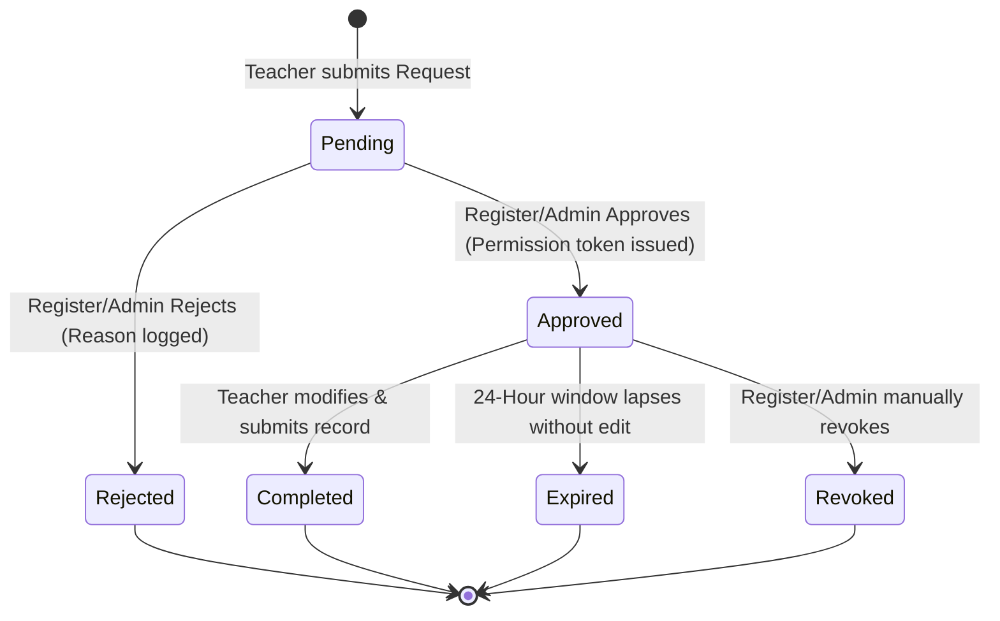
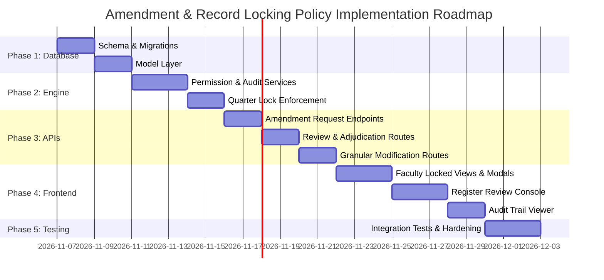

# Grade and Attendance Amendment and Record Locking Policy
## Comprehensive Technical Implementation Plan

> **Document Version:** 1.0.0  
> **Status:** Proposed Architecture & Engineering Roadmap  
> **Target Release:** Capstone v3 — Academic Governance & Audit Enhancement  
> **Author:** System Architecture & Security Engineering  
> **Date:** November 2026  
> **File Location:** `docs/grade-and-attendance-amendment-and-record-locking-plan.md`  

---

## Table of Contents

1. [Executive Summary & Policy Scope](#1-executive-summary--policy-scope)
2. [Existing System Assessment](#2-existing-system-assessment)
   - 2.1 Database Schema & Baseline Migrations
   - 2.2 Backend Architecture & Layering Conventions
   - 2.3 Authentication, RBAC & Actor Resolution
   - 2.4 Gradebook & Score Recording Architecture
   - 2.5 Attendance Recording Architecture
   - 2.6 Quarter Management & Student Record Submission
   - 2.7 Current Security & Governance Gaps
3. [Database Design & Migrations](#3-database-design--migrations)
   - 3.1 Migration Strategy & Sequencing (`0036_...`)
   - 3.2 Schema: `amendment_requests`
   - 3.3 Schema: `amendment_permissions`
   - 3.4 Schema: `amendment_audit_logs`
   - 3.5 Entity-Relationship Diagram
   - 3.6 Data Integrity Constraints & Indexes
4. [Quarter Locking Mechanism](#4-quarter-locking-mechanism)
   - 4.1 Locking Policy & Dynamic Determination
   - 4.2 Impact of Quarter Advancement (`currentQuarter`)
   - 4.3 Historical Visibility Guarantee (Read-Only Access)
   - 4.4 Granular Lock Matrix
5. [Amendment Request Workflow](#5-amendment-request-workflow)
   - 5.1 End-to-End Lifecycle State Machine
   - 5.2 Phase 1: Request Initiation (Teacher / Class Adviser)
   - 5.3 Phase 2: Administrative Review & Adjudication (Register / Admin)
   - 5.4 Phase 3: Scoped Execution & Modification (Teacher)
   - 5.5 Phase 4: Automated Verification, Re-Freezing & Permission Consumption
   - 5.6 Expiration & Revocation Rules
6. [Scoped Permission Management Engine](#6-scoped-permission-management-engine)
   - 6.1 The 5-Point Scoping Tuple
   - 6.2 Preventing Permission Leakage
   - 6.3 Resolution & Active Permission Validation
   - 6.4 Handling Atomic Scoped Updates vs. Legacy Batch Endpoints
7. [Backend Implementation Specifications](#7-backend-implementation-specifications)
   - 7.1 Constants & Types (`constant/amendment.ts`)
   - 7.2 Database Models (`model/amendmentRequest.ts`, `amendmentPermission.ts`, `amendmentAudit.ts`)
   - 7.3 Core Services (`service/amendment.ts`, `service/amendmentPermission.ts`)
   - 7.4 Enforcement Middleware & Service Guards
   - 7.5 Refactoring Existing Services (`studentScore.ts`, `studentAttendance.ts`, `studentRecord.ts`)
   - 7.6 API Endpoints & Route Definitions
   - 7.7 Concurrency Control & Transaction Management
8. [Frontend Implementation Specifications](#8-frontend-implementation-specifications)
   - 8.1 Faculty Interface: Gradebook (`FacultyGradebook.tsx`)
   - 8.2 Faculty Interface: Attendance (`FacultyAttendance.tsx`)
   - 8.3 Faculty Interface: Student Records (`FacultyStudentRecords.tsx`)
   - 8.4 Faculty Interface: Amendment Tracker & Status Banner
   - 8.5 Register / Admin Interface: Amendment Review & Approval Queue (`RecordConfirmations.tsx` / `AdminAmendments.tsx`)
   - 8.6 Register / Admin Interface: Comprehensive Audit Trail Viewer
   - 8.7 Shared UI Components & Modal Dialogs
9. [Audit Trail & Compliance Architecture](#9-audit-trail--compliance-architecture)
   - 9.1 Immutable Audit Log Structure
   - 9.2 Before/After State Snapshotting Engine
   - 9.3 Cryptographic Non-Repudiation & Traceability
   - 9.4 Regulatory Compliance (DepEd Order No. 8, s. 2015 & Form 137/SF10 Standards)
10. [Security Analysis & Edge Cases](#10-security-analysis--edge-cases)
    - 10.1 Protection Against Bypassing Frontend Controls
    - 10.2 Race Conditions & Concurrent Submission Handling
    - 10.3 Clock Drift & Time-Based Expiration Vulnerabilities
    - 10.4 Privilege Escalation & Cross-Teacher Modification Attacks
    - 10.5 Incomplete Edits & Orphaned Permissions
11. [Testing Strategy & Quality Assurance](#11-testing-strategy--quality-assurance)
    - 11.1 Unit Test Coverage
    - 11.2 Integration & API Test Suite
    - 11.3 RBAC & Boundary Negative Test Cases
    - 11.4 End-to-End User Journey Tests
12. [Deployment & Safe Migration Roadmap](#12-deployment--safe-migration-roadmap)
    - 12.1 Backward Compatibility Assurance
    - 12.2 Database Migration Execution Plan
    - 12.3 Rollback Plan & Safety Nets
13. [Phased Implementation Schedule & Acceptance Criteria](#13-phased-implementation-schedule--acceptance-criteria)
    - Phase 1: Database Migration & Persistence Models
    - Phase 2: Core Permission Engine & Backend Authorization Guards
    - Phase 3: Route Integration & Service Guard Enforcements
    - Phase 4: Register & Admin Approval API Suite
    - Phase 5: Frontend Faculty Request & Locked-State UX
    - Phase 6: Frontend Register/Admin Review & Audit Dashboard
    - Phase 7: Verification, Hardening & Security Audit

---

## 1. Executive Summary & Policy Scope

In educational institutions, student grades and daily attendance records are legal documents subject to strict regulatory oversight (specifically DepEd standards in the Philippine educational framework). In the current **GradeSync (Capstone v3)** system, quarterly student records can be submitted and frozen by class advisers, but two major governance vulnerabilities remain:
1. **Unrestricted Reopening:** Class advisers can unilaterally click "Reopen" on any previously submitted student record without administrative oversight, allowing silent post-submission tampering.
2. **Missing Quarter Locking in Operational Modules:** When the academic period advances to Quarter 2, 3, or 4, the operational gradebook (`assessments`, `student_scores`) and attendance modules (`student_attendance`, `class_daily_attendance`) leave past quarters editable by teachers without restrictions.

This technical plan defines the **Grade and Attendance Amendment and Record Locking Policy**. The policy mandates:
- **Automatic Quarter Locking:** Advancing `academic_settings.currentQuarter` automatically locks all gradebook, assessment, and attendance records from earlier quarters system-wide.
- **Mandatory Administrative Approval:** No teacher or class adviser can modify a locked record or a previously finalized student record without submitting a formal **Amendment Request** to the **Register** or **Admin**.
- **Surgically Scoped Permissions:** Approval grants temporary editing access strictly bounded by a 5-point tuple: `(Requester, Student, Subject, Quarter, RecordType)`. An approval never unlocks a whole class, never unlocks other students, and never unlocks unrelated quarters or subjects.
- **Automatic Relocking & Expiration:** Permissions expire automatically upon completion of the approved edit or after a hard time window (e.g., 24 hours), returning records immediately to their locked state.
- **Permanent, Immutable Audit Trail:** Every action (request, review, approval, rejection, and the exact before/after diff of every cell modified) is permanently logged with actor identities, timestamps, and network metadata.

---

## 2. Existing System Assessment

### 2.1 Database Schema & Baseline Migrations

The database is MySQL 8.0/MariaDB managed via a custom file-based migration runner (`server/src/migrations/runner.ts`), executing sequential SQL files (`0000_...` to `0035_...`) tracked in `schema_migrations`.

Key existing tables relevant to this policy:
* **`academic_settings`** (`0013`): Single-row configuration with `currentQuarter` (1–4), `numQuarters` (3–4), `enrollmentOpen` (0/1), and `submissionsLocked` (0/1).
* **`assessments`** (`0019`): Stores activities (`written_work`, `performance_task`, `quarterly_assessment`) linked to `classSubjectId`, `quarter`, `maxScore`, and `componentId`.
* **`student_scores`** (`0020`): Stores scores per `(assessmentId, enrollmentId)`. Unique constraint: `uq_score_once (assessmentId, enrollmentId)`.
* **`class_daily_attendance`** (`0021`): Adviser-level daily attendance (`classId`, `enrollmentId`, `date`, `status`, `quarter`). Unique constraint: `uq_class_attendance_once (classId, enrollmentId, date)`.
* **`student_attendance`** (`0022`): Subject-level daily attendance (`classSubjectId`, `enrollmentId`, `status`, `quarter`, `date`). Unique constraint: `uq_attendance_once (classSubjectId, enrollmentId, date)`.
* **`student_academic_records`** (`0023`): Enrollment-level snapshot header (`enrollmentId`, `classSection`, `classGradeLevel`, `adviserName`).
* **`student_academic_record_subjects`** (`0024`): Frozen per-subject quarterly grades (`recordId`, `subjectName`, `subjectCode`, `q1`, `q2`, `q3`, `q4`).
* **`student_academic_record_quarters`** (`0025`): Quarter submission ledger (`recordId`, `quarter`, `status` ['pending','submitted'], `submittedAt`, `submittedBy`). Extended in `0034` with `confirmedAt` and `confirmedBy` (Register SF10 sign-off).
* **`faculties`** (`0002`): Faculty profiles linked to `users.id` with `role` enum (`teacher`, `register`).
* **`class_subjects`** (`0009`): Subject teaching assignments (`classId`, `facultyId`, `subjectId`).
* **`class_adviser`** (`0010`): Adviser assignments (`classId`, `facultyId`).

### 2.2 Backend Architecture & Layering Conventions

The backend follows an explicit layered architecture with strict separation of concerns:
```
Routes (middleware pipeline)
  └── Controllers (HTTP parameter validation, response envelope)
       └── Services (business logic, security assertions, transactions)
            └── Models (SQL queries, database pool connections)
```
- **Responses:** Standardized via `SuccessResponse({ message, data })` in `server/src/helper/response.js`.
- **Errors:** Custom domain errors inheriting from `AppError` in `server/src/middleware/errors.js` (`BadRequestError`, `ForbiddenError`, `NotFoundError`, `ConflictError`, `InternalServerError`), handled by `server/src/middleware/errorHandler.ts`.
- **Connection Pool:** MySQL connections managed via `getDBPoolConnection()` in `server/src/config/database.ts`. Multi-step operations explicitly acquire dedicated `PoolConnection` instances, using `beginTransaction()`, `commit()`, and `rollback()` inside `try...finally { connection.release(); }` blocks.

### 2.3 Authentication, RBAC & Actor Resolution

- **Authentication:** `ValidateToken` middleware (`server/src/middleware/validateToken.ts`) parses the HTTP-only cookie `login_token` via JWT, setting `req.user` (`id`, `email`, `role`).
- **User Roles:** `ROLES` in `server/src/constant/users.ts`: `admin`, `teacher`, `student`, `developer`.
- **Faculty Roles:** `faculties.role` in `server/src/constant/faculties.ts`: `teacher`, `register`. Faculty members authenticate as `users.role = "teacher"`, and their specific capabilities are resolved via `allowedFacultyRoles.ts`.
- **Actor Resolution:** `server/src/service/authorization.ts` provides centralized helpers:
  - `resolveActorFacultyId(actor)`: Returns `null` for admin/developer, verified `faculties.id` for teachers, throws 403 for others.
  - `resolveTeachingFacultyId(actor)`: Strictly resolves teaching faculty.
  - `resolveRegisterFacultyId(actor)`: Strictly resolves registration staff.
  - `assertFacultyOwnsClassSubject(facultyId, classSubjectId)`: Enforces horizontal ownership.

### 2.4 Gradebook & Score Recording Architecture

- **Gradebook Controller:** `server/src/controller/assessments.ts` exposes:
  - `POST /assessments`: Creates an assessment.
  - `PATCH /assessments/:id`: Updates title, type, maxScore, dateGiven.
  - `DELETE /assessments/:id`: Deletes an assessment (cascades to scores).
  - `POST /assessments/:id/scores`: Batch-saves scores (`{ scores: [{ enrollmentId, score }] }`).
- **Calculation:** `server/src/service/gradebook.ts` calculates live quarter grades on-the-fly from raw `student_scores` weighted by `grading_weights` (Written Work, Performance Tasks, Quarterly Exam).
- **Vulnerability:** None of the assessment or score endpoints check whether `quarter < currentQuarter`. A teacher can currently modify scores for any quarter at any time.

### 2.5 Attendance Recording Architecture

- **Attendance Controller:** `server/src/controller/attendance.ts` exposes:
  - `POST /api/attendance`: Batch-saves attendance for a date (`{ classSubjectId, date, quarter, entries: [{ enrollmentId, status }] }`).
- **Service Logic:** `saveAttendanceByClassSubjectAndDateService` upserts into `student_attendance` and, if the faculty is also the class adviser, duplicates into `class_daily_attendance`.
- **Vulnerability:** No quarter locking check exists. A teacher can submit attendance for any past quarter, overwriting historical records.

### 2.6 Quarter Management & Student Record Submission

- **Advancement Guard:** `updateAcademicSettingsService` in `server/src/service/academicSettings.ts` blocks advancing `currentQuarter` unless `assertQuarterCompleteService(currentQuarter)` passes (all students submitted by advisers).
- **Freezing Snapshot:** Class advisers freeze grades using `submitStudentRecordService` in `server/src/service/studentRecord.ts`, writing computed grades into `student_academic_record_subjects` and recording `status='submitted'` in `student_academic_record_quarters`.
- **The "Reopen" Hole:** Currently, `reopenStudentRecordController` (`POST /api/student-records/class/:classId/students/:enrollmentId/quarter/:quarter/reopen`) allows the class adviser to unilaterally flip `status='pending'`, unlocking the record without any approval from the Register or Admin.

### 2.7 Current Security & Governance Gaps

| Module | Current Behavior | Required Policy Behavior | Risk Level |
|---|---|---|---|
| **Student Records Reopening** | Adviser clicks "Reopen", status immediately changes to pending. | Adviser must request amendment; Register/Admin must approve; single student record temporarily opened. | **Critical** (Integrity breach) |
| **Past Quarter Gradebook** | Fully editable if user knows/selects past quarter in UI. | Read-only by default. Edits require approved amendment scoped to student & subject. | **High** (Audit failure) |
| **Past Quarter Attendance** | Fully editable for any past date/quarter. | Read-only by default. Edits require approved amendment scoped to student & date. | **Medium** (Compliance breach) |
| **Granularity of Edits** | Batch saves overwrite all students in an assessment or attendance sheet. | Approvals must only authorize edits for the specific approved student. | **Critical** (Privilege leak) |
| **Audit Logging** | Overwrites update `student_scores.updated_at` without historical diff or justification. | Complete immutable log capturing requester, approver, reason, before/after values, and timestamps. | **High** (Non-repudiation failure) |

---

## 3. Database Design & Migrations

### 3.1 Migration Strategy & Sequencing (`0036_...`)

The current migration directory ends at `0035_create_school_logo_chunks.sql`. The new policy will be established via baseline migration:
`server/migrations/0036_create_amendment_requests_and_audit.sql`

This migration is 100% additive, safe for production environments, and adheres to MySQL 8 / MariaDB syntax with full foreign key constraints and index optimizations.

### 3.2 Schema: `amendment_requests`

Tracks the formal request lifecycle from submission to resolution.

```sql
CREATE TABLE IF NOT EXISTS `amendment_requests` (
  `id` bigint(20) NOT NULL AUTO_INCREMENT,
  `requestNumber` varchar(32) NOT NULL,                      -- e.g. "AMD-2026-0001"
  `requesterFacultyId` bigint(20) NOT NULL,                  -- faculties.id
  `enrollmentId` bigint(20) NOT NULL,                        -- enrollments.id
  `classSubjectId` bigint(20) DEFAULT NULL,                  -- class_subjects.id (NULL if class-level attendance)
  `classId` int(11) NOT NULL,                                -- classrooms.id
  `quarter` tinyint(4) NOT NULL,                             -- 1 to 4
  `recordType` enum('gradebook_score','student_record_grade','attendance') NOT NULL,
  `reason` text NOT NULL,                                    -- Justification for amendment
  `details` longtext CHARACTER SET utf8mb4 COLLATE utf8mb4_bin NOT NULL CHECK (json_valid(`details`)),
  `status` enum('pending','approved','rejected','completed','expired','revoked') NOT NULL DEFAULT 'pending',
  `reviewerUserId` bigint(20) DEFAULT NULL,                  -- users.id (admin or register faculty's user)
  `reviewedAt` datetime DEFAULT NULL,
  `rejectionReason` text DEFAULT NULL,
  `completedAt` datetime DEFAULT NULL,
  `created_at` timestamp NOT NULL DEFAULT CURRENT_TIMESTAMP,
  `updated_at` timestamp NOT NULL DEFAULT CURRENT_TIMESTAMP ON UPDATE CURRENT_TIMESTAMP,
  PRIMARY KEY (`id`),
  UNIQUE KEY `uq_amendment_request_number` (`requestNumber`),
  KEY `fk_amd_requester` (`requesterFacultyId`),
  KEY `fk_amd_enrollment` (`enrollmentId`),
  KEY `fk_amd_class_subject` (`classSubjectId`),
  KEY `fk_amd_class` (`classId`),
  KEY `fk_amd_reviewer` (`reviewerUserId`),
  KEY `idx_amd_status_quarter` (`status`, `quarter`),
  KEY `idx_amd_student_lookup` (`enrollmentId`, `quarter`, `recordType`),
  CONSTRAINT `fk_amd_requester` FOREIGN KEY (`requesterFacultyId`) REFERENCES `faculties` (`id`) ON DELETE CASCADE ON UPDATE CASCADE,
  CONSTRAINT `fk_amd_enrollment` FOREIGN KEY (`enrollmentId`) REFERENCES `enrollments` (`id`) ON DELETE CASCADE ON UPDATE CASCADE,
  CONSTRAINT `fk_amd_class_subject` FOREIGN KEY (`classSubjectId`) REFERENCES `class_subjects` (`id`) ON DELETE CASCADE ON UPDATE CASCADE,
  CONSTRAINT `fk_amd_class` FOREIGN KEY (`classId`) REFERENCES `classrooms` (`id`) ON DELETE CASCADE ON UPDATE CASCADE,
  CONSTRAINT `fk_amd_reviewer` FOREIGN KEY (`reviewerUserId`) REFERENCES `users` (`id`) ON DELETE SET NULL ON UPDATE CASCADE
) ENGINE=InnoDB DEFAULT CHARSET=utf8mb4 COLLATE=utf8mb4_general_ci;
```

### 3.3 Schema: `amendment_permissions`

Represents active, temporary authorization tokens granted upon request approval.

```sql
CREATE TABLE IF NOT EXISTS `amendment_permissions` (
  `id` bigint(20) NOT NULL AUTO_INCREMENT,
  `requestId` bigint(20) NOT NULL,                           -- 1:1 with amendment_requests
  `facultyId` bigint(20) NOT NULL,                          -- Authorized teacher
  `enrollmentId` bigint(20) NOT NULL,                        -- Authorized student
  `classSubjectId` bigint(20) DEFAULT NULL,                  -- Authorized subject (NULL for class attendance)
  `classId` int(11) NOT NULL,                                -- Authorized classroom
  `quarter` tinyint(4) NOT NULL,                             -- Authorized quarter
  `recordType` enum('gradebook_score','student_record_grade','attendance') NOT NULL,
  `assessmentId` bigint(20) DEFAULT NULL,                    -- Optional granular assessment lock
  `attendanceDate` date DEFAULT NULL,                        -- Optional granular date lock
  `status` enum('active','consumed','revoked','expired') NOT NULL DEFAULT 'active',
  `expiresAt` datetime NOT NULL,                             -- Hard expiration timestamp
  `consumedAt` datetime DEFAULT NULL,                        -- When edit was executed
  `created_at` timestamp NOT NULL DEFAULT CURRENT_TIMESTAMP,
  PRIMARY KEY (`id`),
  UNIQUE KEY `uq_perm_request` (`requestId`),
  KEY `fk_perm_faculty` (`facultyId`),
  KEY `fk_perm_enrollment` (`enrollmentId`),
  KEY `idx_perm_lookup` (`facultyId`, `enrollmentId`, `quarter`, `recordType`, `status`, `expiresAt`),
  CONSTRAINT `fk_perm_request` FOREIGN KEY (`requestId`) REFERENCES `amendment_requests` (`id`) ON DELETE CASCADE ON UPDATE CASCADE,
  CONSTRAINT `fk_perm_faculty` FOREIGN KEY (`facultyId`) REFERENCES `faculties` (`id`) ON DELETE CASCADE ON UPDATE CASCADE,
  CONSTRAINT `fk_perm_enrollment` FOREIGN KEY (`enrollmentId`) REFERENCES `enrollments` (`id`) ON DELETE CASCADE ON UPDATE CASCADE
) ENGINE=InnoDB DEFAULT CHARSET=utf8mb4 COLLATE=utf8mb4_general_ci;
```

### 3.4 Schema: `amendment_audit_logs`

An append-only, tamper-evident ledger recording all state changes and data modifications.

```sql
CREATE TABLE IF NOT EXISTS `amendment_audit_logs` (
  `id` bigint(20) NOT NULL AUTO_INCREMENT,
  `requestId` bigint(20) DEFAULT NULL,                      -- Linked request (if applicable)
  `action` enum('requested','approved','rejected','modified','reopened','re_submitted','consumed','expired','revoked') NOT NULL,
  `actorUserId` bigint(20) NOT NULL,                        -- users.id
  `actorRole` varchar(30) NOT NULL,                         -- Role at time of action
  `recordType` enum('gradebook_score','student_record_grade','attendance') NOT NULL,
  `enrollmentId` bigint(20) NOT NULL,
  `quarter` tinyint(4) NOT NULL,
  `targetTable` varchar(64) NOT NULL,                       -- e.g. "student_scores", "student_academic_record_subjects"
  `targetRecordId` varchar(64) NOT NULL,                    -- PK or composite key of modified row
  `beforeState` longtext CHARACTER SET utf8mb4 COLLATE utf8mb4_bin DEFAULT NULL CHECK (`beforeState` IS NULL OR json_valid(`beforeState`)),
  `afterState` longtext CHARACTER SET utf8mb4 COLLATE utf8mb4_bin DEFAULT NULL CHECK (`afterState` IS NULL OR json_valid(`afterState`)),
  `diff` longtext CHARACTER SET utf8mb4 COLLATE utf8mb4_bin DEFAULT NULL CHECK (`diff` IS NULL OR json_valid(`diff`)),
  `reason` text DEFAULT NULL,
  `ipAddress` varchar(45) DEFAULT NULL,
  `userAgent` text DEFAULT NULL,
  `created_at` timestamp NOT NULL DEFAULT CURRENT_TIMESTAMP,
  PRIMARY KEY (`id`),
  KEY `fk_audit_request` (`requestId`),
  KEY `fk_audit_actor` (`actorUserId`),
  KEY `idx_audit_enrollment` (`enrollmentId`, `quarter`),
  KEY `idx_audit_action_created` (`action`, `created_at`),
  CONSTRAINT `fk_audit_request` FOREIGN KEY (`requestId`) REFERENCES `amendment_requests` (`id`) ON DELETE SET NULL ON UPDATE CASCADE,
  CONSTRAINT `fk_audit_actor` FOREIGN KEY (`actorUserId`) REFERENCES `users` (`id`) ON DELETE NO ACTION ON UPDATE CASCADE
) ENGINE=InnoDB DEFAULT CHARSET=utf8mb4 COLLATE=utf8mb4_general_ci;
```

### 3.5 Entity-Relationship Diagram



### 3.6 Data Integrity Constraints & Indexes

1. **Anti-Duplication Constraint:** An active or pending request for the identical tuple `(requesterFacultyId, enrollmentId, classSubjectId, quarter, recordType)` prevents duplicate submissions. Handled via functional unique index or transaction guard:
   ```sql
   CREATE UNIQUE INDEX `uq_active_pending_request` 
   ON `amendment_requests` (`enrollmentId`, `classSubjectId`, `quarter`, `recordType`, (CASE WHEN `status` IN ('pending','approved') THEN `status` ELSE NULL END));
   ```
2. **Audit Immutability:** No `UPDATE` or `DELETE` statements will ever be issued against `amendment_audit_logs`. (Database user permissions can optionally revoke `UPDATE` and `DELETE` on this table).
3. **Optimized Lookup Index:** `idx_perm_lookup` on `(facultyId, enrollmentId, quarter, recordType, status, expiresAt)` ensures that checking edit rights on every score keystroke executes in $< 1\text{ ms}$.

---

## 4. Quarter Locking Mechanism

### 4.1 Locking Policy & Dynamic Determination

A record is defined as **Locked** if either of the following conditions is true:

$$\text{isLocked} = (\text{record.quarter} < \text{academic\_settings.currentQuarter}) \lor (\text{isQuarterSubmitted}(\text{enrollmentId}, \text{record.quarter}))$$

- **Rule 1 (Past Quarter Lock):** Any assessment, score, or attendance row where `quarter < currentQuarter` is automatically locked system-wide.
- **Rule 2 (Finalized Record Lock):** In the active quarter, once a class adviser submits a student's quarter record (`student_academic_record_quarters.status = 'submitted'`), that student's record and underlying scores are frozen.
- **Rule 3 (System-wide Admin Lock):** If `academic_settings.submissionsLocked = 1`, all modifications and reopen requests are locked across all quarters.

### 4.2 Impact of Quarter Advancement (`currentQuarter`)

When an administrator updates `currentQuarter` from $N$ to $N+1$ in `server/src/service/academicSettings.ts`:
1. The transition passes `assertQuarterCompleteService(currentQuarter)`.
2. As soon as `model.updateSettings(id, { currentQuarter: N+1 })` commits:
   - All records for Quarter $N$ instantly become **Past Quarter** records.
   - Without updating a single row in `assessments`, `student_scores`, or `student_attendance`, the dynamic lock takes effect immediately.
   - Teachers querying Quarter $N$ receive read-only data.
   - Any write (`POST`, `PATCH`, `DELETE`) targeting Quarter $N$ is rejected with `403 Forbidden` unless an active amendment permission is attached.

### 4.3 Historical Visibility Guarantee (Read-Only Access)

Locking **never** restricts data visibility.
- All `GET` routes (`/assessments`, `/gradebook`, `/attendance`, `/attendance/range`, `/student-records/class/:id`) remain fully accessible for all quarters.
- Teachers, advisers, and administrators can inspect historical grades, calculate analytics, and print historical SF9/SF10 documents at any time.

### 4.4 Granular Lock Matrix

| Operation | Current Quarter (Unsubmitted) | Current Quarter (Submitted) | Past Quarter (No Permission) | Past Quarter (Active Permission) |
|---|---|---|---|---|
| **Create/Edit Assessment** | Allowed | Allowed (Live computation) | **Blocked (403)** | Allowed (Scoped) |
| **Save Student Scores** | Allowed | Frozen on Record | **Blocked (403)** | **Allowed ONLY for Approved Student** |
| **Save Class Attendance** | Allowed | Allowed | **Blocked (403)** | **Allowed ONLY for Approved Student/Date** |
| **Reopen Student Record** | Blocked without Approval | Blocked without Approval | **Blocked without Approval** | **Allowed (Adviser execution)** |
| **View Grades & History** | Allowed | Allowed | Allowed | Allowed |

---

## 5. Amendment Request Workflow

### 5.1 End-to-End Lifecycle State Machine



### 5.2 Phase 1: Request Initiation (Teacher / Class Adviser)

1. **Trigger:** A teacher in the Gradebook/Attendance view or a Class Adviser in Student Records attempts to modify a locked student record.
2. **Action:** The teacher opens the **"Request Amendment"** modal dialog.
3. **Payload Structure:**
   ```json
   {
     "enrollmentId": 142,
     "classSubjectId": 18,
     "quarter": 1,
     "recordType": "gradebook_score",
     "reason": "Computation error in Written Work #3 due to misread test booklet.",
     "details": {
       "assessmentId": 52,
       "assessmentTitle": "Written Work 3 - Polynomials",
       "currentScore": 12.0,
       "proposedScore": 18.0,
       "currentQuarterGrade": 82.4,
       "expectedQuarterGrade": 85.1
     }
   }
   ```
4. **Backend Processing:**
   - Validates that the requester actually owns the class-subject (or is the class adviser).
   - Generates human-readable `requestNumber` (e.g., `AMD-2026-0042`).
   - Inserts row into `amendment_requests` with `status = 'pending'`.
   - Records an entry in `amendment_audit_logs` (`action = 'requested'`).

### 5.3 Phase 2: Administrative Review & Adjudication (Register / Admin)

1. **Dashboard Queue:** The Register/Admin navigates to **"Amendment Requests"** (`/register/amendments` or `/admin/amendments`).
2. **Review Dialog:** The reviewer examines:
   - Requester identity and role.
   - Student name, LRN, class section, and subject.
   - Stated reason and proposed score differences.
   - Current status of the student's SF10 confirmation.
3. **Adjudication Decisions:**
   - **Reject:** Reviewer inputs a mandatory rejection reason. Status becomes `rejected`. Audit log records action. Request terminates.
   - **Approve:** Reviewer selects permission duration (default: 24 hours, options: 12h, 24h, 48h).
     - Updates `amendment_requests`: `status = 'approved'`, `reviewerUserId`, `reviewedAt`.
     - Inserts row into `amendment_permissions` with calculated `expiresAt = NOW() + INTERVAL duration HOUR`.
     - Invalidates any existing SF10 registrar confirmation (`confirmedAt = NULL`) to ensure unverified documents cannot be printed.
     - Logs `approved` action to `amendment_audit_logs`.

### 5.4 Phase 3: Scoped Execution & Modification (Teacher)

1. **Notification & UI State:** The teacher's interface reflects the approved status:
   - An active banner indicates: *"You have an active amendment permission for Juan Dela Cruz (Mathematics 9, Q1). Expires in 23h 45m."*
   - In the Gradebook or Attendance grid, **only the approved student's cell** transitions from disabled to editable. All other cells remain strictly locked.
2. **Execution:**
   - Teacher modifies the score or attendance.
   - Clicks **"Save Amendment"**.
   - The frontend sends the update along with the `requestId`.

### 5.5 Phase 4: Automated Verification, Re-Freezing & Permission Consumption

1. **Transaction Integrity:** Inside an atomic database transaction:
   - Validates that `amendment_permissions` is `active` and `expiresAt > NOW()`.
   - Captures `beforeState` (current row in `student_scores` or `student_attendance`).
   - Executes the update to the targeted table.
   - Captures `afterState` and computes the exact JSON diff.
   - Updates `amendment_permissions`: `status = 'consumed'`, `consumedAt = NOW()`.
   - Updates `amendment_requests`: `status = 'completed'`, `completedAt = NOW()`.
   - If this was a finalized student record, recalculates the quarter grade, re-freezes `student_academic_record_subjects`, and marks `student_academic_record_quarters.status = 'submitted'`.
   - Inserts permanent record into `amendment_audit_logs`.
2. **Immediate Lock Restored:** The cell immediately returns to the locked/disabled state. No subsequent modifications are possible under that permission.

### 5.6 Expiration & Revocation Rules

- **Automated Query-Time Expiration:** When an amendment check runs, if `expiresAt < NOW()` and `status = 'active'`, the system treats the permission as expired and updates `status = 'expired'`. No cron job dependency is required for immediate security enforcement.
- **Administrative Revocation:** An admin or registrar can click **"Revoke Permission"** at any point prior to consumption, immediately canceling the authorization.

---

## 6. Scoped Permission Management Engine

### 6.1 The 5-Point Scoping Tuple

To guarantee zero permission leakage, every permission is bounded by:

$$\mathcal{P} = \langle \text{FacultyId}, \text{EnrollmentId}, \text{ClassSubjectId}, \text{Quarter}, \text{RecordType} \rangle$$

```
┌───────────────────────────────────────────────────────────┐
│                 5-POINT SCOPING TUPLE                     │
├───────────────────┬───────────────────────────────────────┤
│ 1. FacultyId      │ Strictly the authorized teacher       │
│ 2. EnrollmentId   │ Strictly the authorized student       │
│ 3. ClassSubjectId │ Strictly the authorized subject       │
│ 4. Quarter        │ Strictly the authorized quarter (1-4) │
│ 5. RecordType     │ Gradebook, Final Record, or Attend.   │
└───────────────────┴───────────────────────────────────────┘
```

### 6.2 Preventing Permission Leakage

Approving a request for **Student A** in **Math** for **Quarter 1**:
1. **Never unlocks Student B:** Student B remains locked; any attempt to write Student B fails.
2. **Never unlocks Quarter 2:** Quarter 2 remains locked or follows its own independent state.
3. **Never unlocks Science:** The teacher cannot touch other subjects.
4. **Never unlocks Other Teachers:** Another teacher sharing the section cannot edit.
5. **Never unlocks Class Roster:** No bulk update can slip through.

### 6.3 Resolution & Active Permission Validation

The backend executes this assertion before permitting any write to a locked resource:

```typescript
export async function assertWritePermission(
    connection: PoolConnection,
    actorFacultyId: number | null,
    scope: {
        enrollmentId: number;
        classSubjectId?: number;
        classId?: number;
        quarter: number;
        recordType: "gradebook_score" | "student_record_grade" | "attendance";
        assessmentId?: number;
    }
): Promise<number | null> {
    // 1. Privileged users (admin) bypass ownership, but must still have an audit trail
    if (actorFacultyId === null) {
        return null;
    }

    // 2. Check if the quarter is currently open and unlocked
    const settingsModel = new AcademicSettingsModel(connection);
    const settings = await settingsModel.getSettings();
    const isCurrentQuarter = settings?.currentQuarter === scope.quarter;
    const isSystemLocked = Boolean(settings?.submissionsLocked);

    if (isSystemLocked) {
        throw new ForbiddenError("All submissions and amendments are locked by the administrator");
    }

    // If it's the current quarter, check if the student record has already been submitted/frozen
    if (isCurrentQuarter && scope.recordType === "gradebook_score") {
        const recordModel = new StudentRecordModel(connection);
        const isSubmitted = await recordModel.isStudentQuarterSubmitted(scope.enrollmentId, scope.quarter);
        if (!isSubmitted) {
            // Unlocked current quarter — ordinary edit allowed
            return null;
        }
    } else if (isCurrentQuarter && scope.recordType === "attendance") {
        // Current quarter attendance is open
        return null;
    }

    // 3. Resource is LOCKED (past quarter or frozen record) — must find active permission
    const query = `
        SELECT id, requestId FROM amendment_permissions
        WHERE facultyId = ?
          AND enrollmentId = ?
          AND (classSubjectId = ? OR (? IS NULL AND classSubjectId IS NULL))
          AND quarter = ?
          AND recordType = ?
          AND status = 'active'
          AND expiresAt > NOW()
        LIMIT 1
        FOR UPDATE
    `;
    const [rows] = await connection.execute<RowDataPacket[]>(query, [
        actorFacultyId,
        scope.enrollmentId,
        scope.classSubjectId ?? null,
        scope.classSubjectId ?? null,
        scope.quarter,
        scope.recordType,
    ]);

    const activePerm = rows[0];
    if (!activePerm) {
        throw new ForbiddenError(
            `Quarter ${scope.quarter} records for this student are locked. An approved amendment request is required.`
        );
    }

    return Number(activePerm.id);
}
```

### 6.4 Handling Atomic Scoped Updates vs. Legacy Batch Endpoints

Existing endpoints (`POST /assessments/:id/scores` and `POST /api/attendance`) accept arrays of students. Under amendment mode, a teacher must only modify the approved student.

**Two Architectural Solutions:**
1. **Targeted Endpoints (Recommended):** Introduce dedicated, granular modification endpoints:
   - `PATCH /api/assessments/:id/scores/:enrollmentId`: Modifies exactly one student's score.
   - `PATCH /api/attendance/:classSubjectId/students/:enrollmentId`: Modifies exactly one student's attendance on a specific date.
2. **Batch Guarding:** In the legacy batch endpoints, if called on a locked quarter:
   - Verify that all unmodified students in the batch match their existing database values exactly (zero delta).
   - Verify that only the single permitted student's score differs.
   - If any other student's value differs, reject the entire transaction with `403 Forbidden: Unauthorized modification of locked student records.`

Both approaches will be implemented: the targeted endpoints for clean, modern frontend usage, and the batch guards to close any bypass attempts via raw API calls.

---

## 7. Backend Implementation Specifications

### 7.1 Constants & Types (`server/src/constant/amendment.ts`)

```typescript
export const AMENDMENT_RECORD_TYPES = {
    GRADEBOOK_SCORE: "gradebook_score",
    STUDENT_RECORD_GRADE: "student_record_grade",
    ATTENDANCE: "attendance",
} as const;

export type AmendmentRecordType = typeof AMENDMENT_RECORD_TYPES[keyof typeof AMENDMENT_RECORD_TYPES];

export const AMENDMENT_STATUSES = {
    PENDING: "pending",
    APPROVED: "approved",
    REJECTED: "rejected",
    COMPLETED: "completed",
    EXPIRED: "expired",
    REVOKED: "revoked",
} as const;

export type AmendmentStatus = typeof AMENDMENT_STATUSES[keyof typeof AMENDMENT_STATUSES];

export interface AmendmentRequestCreateProps {
    enrollmentId: number;
    classSubjectId?: number;
    classId: number;
    quarter: number;
    recordType: AmendmentRecordType;
    reason: string;
    details: {
        assessmentId?: number;
        assessmentTitle?: string;
        attendanceDate?: string;
        currentValue: number | string | null;
        proposedValue: number | string | null;
        [key: string]: unknown;
    };
}

export interface AmendmentRequestRow {
    id: number;
    requestNumber: string;
    requesterFacultyId: number;
    requesterName?: string;
    enrollmentId: number;
    studentName?: string;
    studentLrn?: string;
    classSubjectId: number | null;
    subjectName?: string;
    classId: number;
    section?: string;
    quarter: number;
    recordType: AmendmentRecordType;
    reason: string;
    details: string; // JSON
    status: AmendmentStatus;
    reviewerUserId: number | null;
    reviewerName?: string;
    reviewedAt: string | null;
    rejectionReason: string | null;
    completedAt: string | null;
    created_at: string;
}

export interface AmendmentAuditLogRow {
    id: number;
    requestId: number | null;
    action: string;
    actorUserId: number;
    actorName?: string;
    actorRole: string;
    recordType: string;
    enrollmentId: number;
    quarter: number;
    targetTable: string;
    targetRecordId: string;
    beforeState: string | null; // JSON
    afterState: string | null;  // JSON
    diff: string | null;        // JSON
    reason: string | null;
    ipAddress: string | null;
    userAgent: string | null;
    created_at: string;
}
```

### 7.2 Database Models

New model files to create in `server/src/model/`:
1. **`amendmentRequest.ts`**:
   - `createRequest(data, connection)`
   - `getRequestById(id, connection)`
   - `getRequests(filters, connection)`: Supports filtering by status, quarter, classId, requesterFacultyId.
   - `updateStatus(id, status, reviewerUserId, rejectionReason, connection)`
   - `hasActiveOrPendingRequest(enrollmentId, classSubjectId, quarter, recordType, connection)`
2. **`amendmentPermission.ts`**:
   - `createPermission(data, connection)`
   - `getActivePermission(facultyId, enrollmentId, classSubjectId, quarter, recordType, connection)`
   - `consumePermission(id, connection)`
   - `expireOverduePermissions(connection)`
   - `revokePermission(requestId, connection)`
3. **`amendmentAudit.ts`**:
   - `logAudit(data, connection)`: Append-only insert with before/after serialization.
   - `getAuditLogsByRequest(requestId, connection)`
   - `getAuditLogsByEnrollment(enrollmentId, connection)`
   - `getAuditHistory(filters, connection)`

### 7.3 Core Services

New service files in `server/src/service/`:
1. **`service/amendment.ts`**:
   - `submitAmendmentRequestService(requesterActor, payload)`: Enforces that the teacher teaches the class-subject or advises the class, constructs `requestNumber`, logs `requested` audit event.
   - `reviewAmendmentRequestService(reviewerUser, requestId, decision, rejectionReason, durationHours)`:
     - Runs in a transaction.
     - Validates reviewer has `admin` role or `register` faculty role.
     - If approved: creates `amendment_permissions` entry (`expiresAt = NOW() + duration`), logs `approved`.
     - Invalidates previous SF10 sign-offs (`confirmedAt = NULL`) in `student_academic_record_quarters`.
     - If rejected: updates request status with rejection reason, logs `rejected`.
   - `getAmendmentRequestsService(filters, actor)`: Scoped so teachers only view their own requests; register and admins view all requests.
2. **`service/amendmentPermission.ts`**:
   - `verifyAndConsumePermissionService(connection, facultyId, scope, updateCallback)`: Wraps the resource modification, executes the callback, verifies permissions, records before/after audit diff, and marks permission consumed.

### 7.4 Enforcement Middleware & Service Guards

In `server/src/service/authorization.ts`, add:
- `assertRecordWritable(connection, facultyId, scope)`: Checks quarter locking and calls `assertWritePermission`.

In `server/src/middleware/quarterLockGuard.ts`:
- Optional route-level middleware extracting `classSubjectId`, `quarter`, and `enrollmentId` from parameters to reject locked edits early before hitting heavy controller logic.

### 7.5 Refactoring Existing Services

1. **`service/studentScore.ts`**:
   - Update `saveAssessmentScoresService`:
     - Inspect the assessment's `quarter`.
     - If `quarter < currentQuarter`: verify that any student score being updated has a corresponding active amendment permission.
   - Add `saveSingleStudentScoreService(assessmentId, enrollmentId, score, facultyId, clientIp, userAgent)`:
     - Handles atomic single-student amendment modification inside a dedicated transaction.
     - Logs exact before/after score difference to `amendment_audit_logs`.
2. **`service/studentAttendance.ts`**:
   - Update `saveAttendanceByClassSubjectAndDateService`:
     - Inspect the `quarter` of the attendance date.
     - If locked: reject edits for students without active permissions.
   - Add `saveSingleStudentAttendanceService(...)`:
     - Atomically updates attendance for the approved student and date.
3. **`service/studentRecord.ts`**:
   - Refactor `reopenStudentRecordService`:
     - **BREAKING CHANGE TO UNRESTRICTED REOPEN:** Remove the ability for class advisers to freely reopen records.
     - Require that an approved `amendment_permissions` row exists with `recordType = 'student_record_grade'` for that `enrollmentId` and `quarter`.
     - Upon reopening, consume the permission, update `student_academic_record_quarters.status = 'pending'`, and log the audit entry.

### 7.6 API Endpoints & Route Definitions

New file: `server/src/routes/amendments.ts`:

```typescript
// Teacher routes
router.post("/amendments/requests", facultyOnly, submitAmendmentRequestController);
router.get("/amendments/my-requests", facultyOnly, getMyAmendmentRequestsController);

// Register + Admin review routes
router.get("/amendments/requests", adminRegister, getAllAmendmentRequestsController);
router.get("/amendments/requests/:id", adminRegister, getAmendmentRequestByIdController);
router.post("/amendments/requests/:id/approve", adminRegister, approveAmendmentRequestController);
router.post("/amendments/requests/:id/reject", adminRegister, rejectAmendmentRequestController);
router.post("/amendments/requests/:id/revoke", adminRegister, revokeAmendmentRequestController);

// Audit history route
router.get("/amendments/audit-logs", adminRegister, getAmendmentAuditLogsController);
```

Updated routes in `server/src/routes/assessments.ts`:
```typescript
// Granular single-student score update for amendments
route.patch("/assessments/:id/scores/:enrollmentId", adminFaculty, saveSingleStudentScoreController);
```

Updated routes in `server/src/routes/attendance.ts`:
```typescript
// Granular single-student attendance update for amendments
route.patch("/attendance/class-subjects/:classSubjectId/students/:enrollmentId", adminFaculty, saveSingleStudentAttendanceController);
```

### 7.7 Concurrency Control & Transaction Management

- All modification and approval operations acquire row locks via `SELECT ... FOR UPDATE` on `amendment_requests` and `amendment_permissions`.
- This eliminates race conditions where two simultaneous requests attempt to consume the same permission or approve the same request twice.
- If a database transaction encounters an error during score recalculation, the score update, permission consumption, and audit log write are rolled back together.

---

## 8. Frontend Implementation Specifications

### 8.1 Faculty Interface: Gradebook (`FacultyGradebook.tsx`)

1. **Locked Quarter Detection:**
   ```typescript
   const isPastQuarter = quarter < currentQuarter;
   const isLocked = isPastQuarter || submissionsLocked;
   ```
2. **Visual Indicators:**
   - When viewing a locked quarter, a prominent top banner is displayed:
     > 🔒 **Quarter {quarter} is locked.** Historical records are read-only. To modify a student's score, click the **Request Amendment** icon on the student's row.
   - All input cells default to disabled with subtle lock icons.
3. **Active Amendment Highlighting:**
   - The student row with an active amendment displays an **"Editable — Amendment Approved"** pulsing green badge.
   - Only that student's input cells are enabled.
   - An expiration countdown timer is displayed next to the save button: *"Permission expires in 14h 22m"*.
4. **Action Button:**
   - An "Amend" action icon (`FiFileText`) appears on each student's name cell in locked mode, opening the `RequestAmendmentModal`.

### 8.2 Faculty Interface: Attendance (`FacultyAttendance.tsx`)

1. **Past Quarter Grid Lock:**
   - Overhauls `canEdit = quarterFilter !== ALL_QUARTERS` to:
     ```typescript
     const isQuarterLocked = quarterFilter < currentQuarter || submissionsLocked;
     const canEdit = quarterFilter !== ALL_QUARTERS && (!isQuarterLocked || hasActiveAttendancePermission);
     ```
2. **Cell-Level Authorization:**
   - In locked quarters, individual cells are disabled unless the student's `enrollmentId` matches an active permission.
3. **Amendment Request Dialog:**
   - In locked mode, clicking on a past date cell prompts: *"This quarter is locked. Submit an Amendment Request to change this record."*

### 8.3 Faculty Interface: Student Records (`FacultyStudentRecords.tsx`)

1. **Overhaul of "Reopen" Button:**
   - Current implementation: Click "Reopen" $\rightarrow$ record immediately unlocks.
   - New implementation:
     - If no approved amendment exists, the button reads **"Request Amendment"** (`FiFilePlus`).
     - Clicking opens `RequestStudentRecordAmendmentModal`, explaining that reopening requires Register/Admin approval.
     - If an approved amendment exists, the button reads **"Amend & Reopen"** (`FiUnlock`, highlighted in emerald), enabling the adviser to unlock the record and perform the approved changes.

### 8.4 Faculty Interface: Amendment Tracker & Status Banner

A dedicated **"My Amendments"** panel or tab in the Faculty Dashboard where teachers can track all submitted requests:
- Status chips: **Pending Review**, **Approved (Active)**, **Rejected**, **Completed**, **Expired**.
- Rejection feedback: Displays the exact note left by the registrar.
- Quick link: Jumps directly to the relevant Gradebook or Student Records screen when approved.

### 8.5 Register / Admin Interface: Amendment Review & Approval Queue (`RecordConfirmations.tsx` / `AdminAmendments.tsx`)

A dedicated management console located at `/register/amendments` (and accessible under Admin navigation):
1. **Metrics Bar:**
   - Pending Requests Count, Approved (Active) Permissions, Completed This Term, Rejections.
2. **Filterable Request Table:**
   - Columns: Request #, Timestamp, Requester (Teacher), Class & Section, Subject, Quarter, Student Name, Record Type, Status, Actions.
3. **Review Modal:**
   - Side-by-side diff comparing current score/grade with proposed score/grade.
   - Full explanation from the teacher.
   - Action controls:
     - **Approve Button:** Opens duration selector (12h, 24h, 48h) and confirms authorization.
     - **Reject Button:** Requires a text reason before submission.
     - **Revoke Button:** Immediately voids an active unconsumed permission.

### 8.6 Register / Admin Interface: Comprehensive Audit Trail Viewer

A searchable, read-only audit log viewer:
- Filter by Student LRN, Teacher, Quarter, Date Range, and Action Type.
- Expandable rows displaying JSON state diffs:
  ```json
  {
    "field": "score",
    "before": 14.0,
    "after": 20.0,
    "assessment": "Written Work #2",
    "updatedAt": "2026-11-06T21:45:00Z"
  }
  ```

### 8.7 Shared UI Components & Modal Dialogs

- `RequestAmendmentModal.tsx`: Standardized form across Gradebook, Attendance, and Student Records.
- `AmendmentStatusBadge.tsx`: Consistent visual badges across all roles.
- `ActivePermissionBanner.tsx`: Sticky countdown banner alerting teachers to time-limited permissions.

---

## 9. Audit Trail & Compliance Architecture

### 9.1 Immutable Audit Log Structure

To ensure non-repudiation, the `amendment_audit_logs` table stores:
1. **Who:** `actorUserId`, `actorRole`, `ipAddress`, `userAgent`.
2. **When:** `created_at` (server-side UTC timestamp).
3. **What:** `targetTable`, `targetRecordId`, `recordType`, `quarter`.
4. **Values:** `beforeState` (serialized JSON of old row), `afterState` (serialized JSON of new row), `diff` (explicit Delta).
5. **Context:** `requestId`, `reason`.

### 9.2 Before/After State Snapshotting Engine

A reusable helper function in `server/src/helper/auditDiff.ts`:

```typescript
export function computeAuditDiff<T extends Record<string, any>>(before: T, after: T): Record<string, { old: any; new: any }> {
    const diff: Record<string, { old: any; new: any }> = {};
    const allKeys = new Set([...Object.keys(before), ...Object.keys(after)]);
    for (const key of allKeys) {
        if (before[key] !== after[key]) {
            diff[key] = { old: before[key], new: after[key] };
        }
    }
    return diff;
}
```

### 9.3 Cryptographic Non-Repudiation & Traceability

- Every audit entry is linked back to the verified JWT session ID and `users.id`.
- The database user assigned to the application will have `INSERT` and `SELECT` privileges on `amendment_audit_logs`, with `UPDATE` and `DELETE` explicitly denied.

### 9.4 Regulatory Compliance (DepEd Order No. 8, s. 2015 & Form 137/SF10 Standards)

- Under DepEd grading guidelines, once quarterly records are submitted, corrections require school head or registrar approval.
- An SF10 permanent record must reflect official, validated grades.
- The amendment policy ensures that any post-submission alteration automatically invalidates the Registrar's sign-off (`confirmedAt = NULL`), requiring the Registrar to re-verify the SF10 before official printing.

---

## 10. Security Analysis & Edge Cases

### 10.1 Protection Against Bypassing Frontend Controls

- **Threat:** A tech-savvy teacher inspects DOM elements, removes `disabled` attributes from gradebook inputs, and posts directly to `/assessments/:id/scores`.
- **Mitigation:** The frontend `disabled` state is purely visual. The backend service unconditionally executes `assertRecordWritable` inside the database transaction. If the quarter is locked and no valid permission matches `(facultyId, enrollmentId, quarter)`, the backend aborts with `403 Forbidden` and logs a security warning.

### 10.2 Race Conditions & Concurrent Submission Handling

- **Threat:** A teacher submits two identical requests simultaneously, or two administrators approve/reject the same request concurrently.
- **Mitigation:**
  - Database row locks (`SELECT ... FOR UPDATE`) are applied during state transitions.
  - The unique constraint `uq_active_pending_request` prevents duplicate active requests for the same student-subject-quarter tuple.

### 10.3 Clock Drift & Time-Based Expiration Vulnerabilities

- **Threat:** Client workstation clock is manipulated to extend an expired permission.
- **Mitigation:** Expiration checks rely strictly on database server time (`NOW()`), completely ignoring client-supplied timestamps.

### 10.4 Privilege Escalation & Cross-Teacher Modification Attacks

- **Threat:** Teacher A is granted an amendment for Student X, but attempts to submit changes for Student Y or subject B.
- **Mitigation:** The 5-point scoping check requires every element of the tuple to match. If Teacher A attempts to modify Student Y, the query for an active permission returns empty, throwing `403 Forbidden`.

### 10.5 Incomplete Edits & Orphaned Permissions

- **Threat:** A teacher obtains approval but never executes the change.
- **Mitigation:** The permission automatically transitions to `expired` after the expiration window (e.g. 24 hours). The record remains completely untouched and locked.

---

## 11. Testing Strategy & Quality Assurance

### 11.1 Unit Test Coverage

Located in `server/test/unit/`:
- `quarterLock.test.ts`: Tests `isRecordLocked` across all quarter configurations and edge values.
- `auditDiff.test.ts`: Verifies JSON diff generation, ensuring numerical precision and null handling are preserved.
- `permissionScoping.test.ts`: Verifies that permission matching logic rejects mismatched tuples.

### 11.2 Integration & API Test Suite

Located in `server/test/integration/`:
- `amendmentRequestFlow.test.ts`:
  1. Teacher submits request $\rightarrow$ status is `pending`.
  2. Register reviews and approves with 24h duration $\rightarrow$ status is `approved`, permission created.
  3. Teacher submits score $\rightarrow$ score updated, permission consumed, status `completed`.
  4. Subsequent score edit fails with `403 Forbidden`.
- `amendmentRejectionFlow.test.ts`:
  1. Register rejects request with reason $\rightarrow$ status `rejected`.
  2. Teacher attempts score edit $\rightarrow$ fails with `403 Forbidden`.

### 11.3 RBAC & Boundary Negative Test Cases

- **Unauthorized User:** Student or Developer attempts to approve an amendment $\rightarrow$ `403 Forbidden`.
- **Cross-Faculty Tampering:** Teacher B attempts to use Teacher A's approved permission $\rightarrow$ `403 Forbidden`.
- **Expired Permission Test:** Time is fast-forwarded beyond `expiresAt` $\rightarrow$ edit attempt returns `403 Forbidden: Permission has expired`.
- **Batch Poisoning Test:** Teacher with permission for 1 student submits a batch containing 20 students $\rightarrow$ batch rejected with `403 Forbidden`.

### 11.4 End-to-End User Journey Tests

Located in `client/src/test/`:
- Verify that Faculty Gradebook disables inputs when viewing past quarters.
- Verify that active permissions display the countdown banner and enable only authorized cells.
- Verify Register Amendment Console filtering and one-click approval workflows.

---

## 12. Deployment & Safe Migration Roadmap

### 12.1 Backward Compatibility Assurance

- Existing historical data in `student_scores`, `student_attendance`, and `student_academic_record_subjects` remains completely intact.
- The active current quarter continues to function without interruption.
- Existing confirmed quarters on the SF10 retain their sign-offs; the new policy only activates when a past quarter or frozen record is targeted for modification.

### 12.2 Database Migration Execution Plan

1. Execute migration runner:
   ```bash
   npm run migrate
   ```
2. The runner applies `0036_create_amendment_requests_and_audit.sql`.
3. The runner records the migration in `schema_migrations`.
4. The migration is idempotent (`CREATE TABLE IF NOT EXISTS`).

### 12.3 Rollback Plan & Safety Nets

If rollback is ever required:
1. Drop the three new tables:
   ```sql
   DROP TABLE IF EXISTS `amendment_audit_logs`;
   DROP TABLE IF EXISTS `amendment_permissions`;
   DROP TABLE IF EXISTS `amendment_requests`;
   ```
2. Remove the migration record from `schema_migrations`:
   ```sql
   DELETE FROM `schema_migrations` WHERE `filename` = '0036_create_amendment_requests_and_audit.sql';
   ```
3. Revert backend code to previous release tag. Core gradebook and attendance functionality remain functional as before.

---

## 13. Phased Implementation Schedule & Acceptance Criteria



### Phase 1: Database Migration & Persistence Models
- **Deliverables:** `0036_create_amendment_requests_and_audit.sql`, `model/amendmentRequest.ts`, `model/amendmentPermission.ts`, `model/amendmentAudit.ts`.
- **Acceptance Criteria:** `npm run migrate` runs cleanly; unit tests verify CRUD operations on all three tables with foreign key integrity.

### Phase 2: Core Permission Engine & Backend Authorization Guards
- **Deliverables:** `constant/amendment.ts`, `service/amendmentPermission.ts`, `service/authorization.ts` guard updates.
- **Acceptance Criteria:** `assertRecordWritable` correctly identifies locked quarters and validates active 5-point scoping tuples.

### Phase 3: Route Integration & Service Guard Enforcements
- **Deliverables:** Update `service/studentScore.ts`, `service/studentAttendance.ts`, `service/studentRecord.ts`; add single-student endpoints.
- **Acceptance Criteria:** Direct API writes to past quarters fail with 403; writes with active permissions succeed, consume the permission, and write before/after snapshots to audit logs.

### Phase 4: Register & Admin Approval API Suite
- **Deliverables:** `controller/amendments.ts`, `routes/amendments.ts`, request lifecycle service methods.
- **Acceptance Criteria:** Teachers can submit requests; Register/Admin can list, inspect, approve, and reject requests; approval issues time-bounded permissions.

### Phase 5: Frontend Faculty Request & Locked-State UX
- **Deliverables:** Updates to `FacultyGradebook.tsx`, `FacultyAttendance.tsx`, `FacultyStudentRecords.tsx`; `RequestAmendmentModal.tsx`, `ActivePermissionBanner.tsx`.
- **Acceptance Criteria:** Past quarters display lock indicators; teachers can easily trigger the amendment modal; approved permissions visually unlock only the authorized student cell.

### Phase 6: Frontend Register/Admin Review & Audit Dashboard
- **Deliverables:** `RegisterAmendments.tsx` (and Admin route), review dialog with side-by-side diff, audit trail search table.
- **Acceptance Criteria:** Registrars can view pending requests, review teacher explanations, approve with duration, and search historical audit logs.

### Phase 7: Verification, Hardening & Security Audit
- **Deliverables:** Comprehensive integration test suite, penetration testing for bypass attempts, edge case verification.
- **Acceptance Criteria:** 100% pass rate on test suites; zero permission leakage across students or subjects; formal sign-off from academic administrators.

---

*End of Implementation Plan. Awaiting explicit user authorization prior to executing application or database modifications.*

